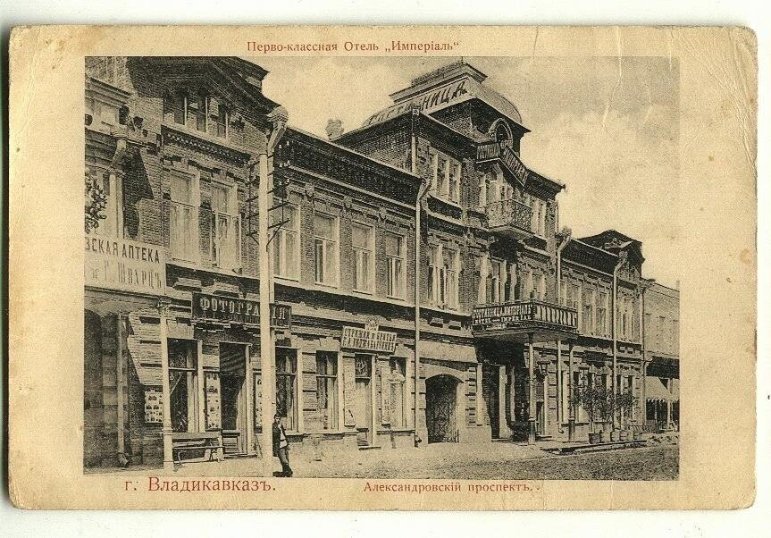
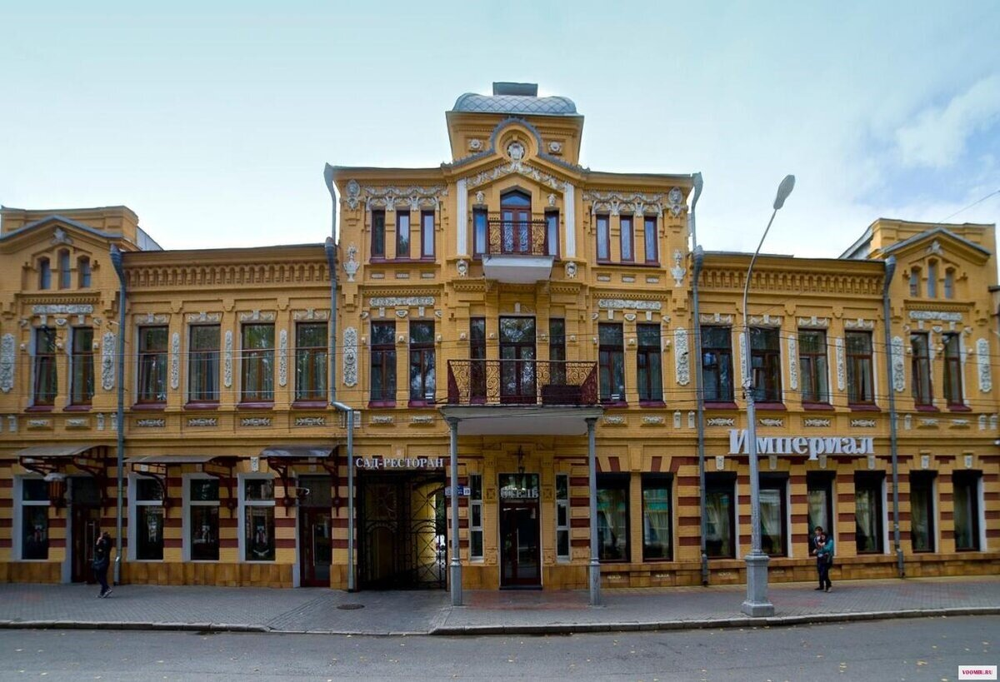

# Гостиница «Империал». Начало Владикавказа.

> **Архивная копия из канала Дзен (эпоха «Одолей», 2024).**
> Источник: https://dzen.ru/a/Zi5hXa7x_1Q_SKl9
> Скопировано 30.10.2026 при чистке канала, перед удалением публикации из Дзена.
> Дата публикации не зафиксирована (на странице канала: «2 года назад»).

---

В 1860 году Владикавказская крепость получила статус города, став столицей Терской области. Привлекая всё больше туристов, Владикавказ стал популярным местом отдыха в пути в Тифлис. К концу XIX века здесь уже существовало 15 гостиниц, хотя комфорт в них оставлял желать лучшего.

В 1894 году Панайот Марандов начал строительство нового гостиничного дома в стиле модерн. Это трехэтажное здание с эстетичным дизайном и использованием металла и стекла выделялось среди других строений города. Однако, планы Марандова на открытие гостиницы не осуществились, и здание перешло в собственность Михаила Кесеридзе, который в 1899 году открыл здесь гостиницу "Империал".

Гостиница "Империал" предлагала комфортабельные номера на верхних этажах, элитный ресторан Сан-Ремо, симфонический оркестр, театр варьете, бильярд и красивый сад. После национализации в 1917 году здание стало штабом наркома Горской АССР, но спустя несколько лет возобновило свою гостиничную деятельность под названием "Палас", а затем "Интурист". С 1991 года гостиница вернула историческое название и продолжает принимать гостей, являясь памятником архитектуры и одним из самых красивых зданий старого Владикавказа.

[ЗАБРОНИРОВАТЬ](https://dzen.ru/away?to=https%3A%2F%2Fostrovok.tp.st%2FkPTaf4nX)

